# Lily58 Layout

### Setup

- Clone the qmk firmware repository

```bash
➜ git clone https://github.com/qmk/qmk_firmware.git
```

- Change directories to the lily58 keymaps directory

```bash
➜ cd ~/qmk_firmware/keyboards/lily58/keymaps
```

- Add this keymap as a submodule

```bash
➜ git submodule add git@github.com:amurani/lily58-keymap.git amurani
```

- Change directories back to the root qmk firmware directory

```bash
➜ cd ~/qmk_firmware
```

- Compile the keymap via the qmk firmware cli

```bash
➜ qmk compile -kb lily58 -km amurani
```

or run the clean command first incase you get weird compilation failures unrelated to your keymap changes

```bash
➜  qmk clean -a && qmk compile -kb lily58 -km amurani
```

- Confirm that the keymap has been compiled to a hex file:

```bash
➜ ls -l | grep lily58_rev1_amurani.hex
```

- Flash the keyboard. This compiles too, then waits for you to press the reset button (or Lower + Raise + Esc once this keymap is already on the board)

```bash
➜ qmk flash -kb lily58 -km amurani
```

- Repeat for the other half (each half has its own controller)

### Layers



The Adjust layer (Lower + Raise) only has `QK_BOOT` on the Esc key, which puts the board into flashing mode.

Regenerate the diagram after changing `keymap.c` using [keymap-drawer](https://github.com/caksoylar/keymap-drawer)

```bash
➜ pipx install keymap-drawer
➜ python3 keymap-drawer/c2json.py keymap.c > /tmp/lily58.json
➜ keymap -c keymap-drawer/config.yaml parse -q /tmp/lily58.json -c 12 -l default lower raise adjust > /tmp/lily58.yaml
➜ keymap -c keymap-drawer/config.yaml draw /tmp/lily58.yaml > keymap-drawer/lily58.svg
```

### Credit

This repository is based on the one under [siketyan/lily58-keymap](https://github.com/siketyan/lily58-keymap) and I thought it would be right to make a note of that.
